# Ocean · Atmosphere · Hydro — численные модели геофизических процессов на Python

Четыре численные модели динамики
океана, взаимодействия океана и атмосферы и речного стока. Переработка университетских лабораторных работ: всё, что раньше
считалось в Excel, реализовано на чистом Python
(`numpy`/`pandas`/`scipy`), а гидрологическая задача дополнена ML-моделью.

> **EN:** Geophysical models (Ekman boundary layer, coupled
> ocean–atmosphere box model, 1-D long waves with numerical dispersion, and a
> river runoff forecasting pipeline) implemented in Python with vectorized
> numpy solvers, optimization-based parameter calibration, and honest
> verification against a persistence baseline — plus a gradient-boosting model
> that beats it.

## Проекты

| № | Ноутбук | Модель | Ключевой результат |
|---|---|---|---|
| 01 | [Пограничный слой Экмана](notebooks/01_ekman_boundary_layer.ipynb) | стационарные профили ветра и дрейфового течения, годограф через границу раздела | океану достаётся ~2% импульса геострофического ветра (V₀ ≈ 0.23 м/с при Vg = 12 м/с) |
| 02 | [Боксовая модель «атмосфера–океан»](notebooks/02_ocean_atmosphere_box_model.ipynb) | 3 резервуара температуры, РК4 + точное спектральное решение | фактический порядок РК4 ≈ 4.0 подтверждён; память системы — глубокий океан, τ ≈ 96 лет |
| 03 | [Длинные волны в бассейне](notebooks/03_long_waves_1d.ipynb) | линейные уравнения мелкой воды на разнесённой C-сетке, CFL = 0.5 | вычислительная дисперсия: ошибка амплитуды 12% при 8 ячейках/λ и 1.4% при 80 |
| 04 | [Прогноз стока Колымы](notebooks/04_kolyma_runoff_forecast.ipynb) | линейный резервуар + калибровка (сетка + L-BFGS-B) против бустинга | физическая модель без навыка (S/σ_ΔQ ≈ 9), бустинг даёт навык (S/σ_ΔQ = 0.91) |

---

## 01 · Пограничный слой Экмана

Связанный пограничный слой «атмосфера–океан»: геострофический ветер
раскручивается к поверхности, порождая дрейфовое течение; годограф скорости
строится единой кривой от свободной атмосферы до океанской спирали.

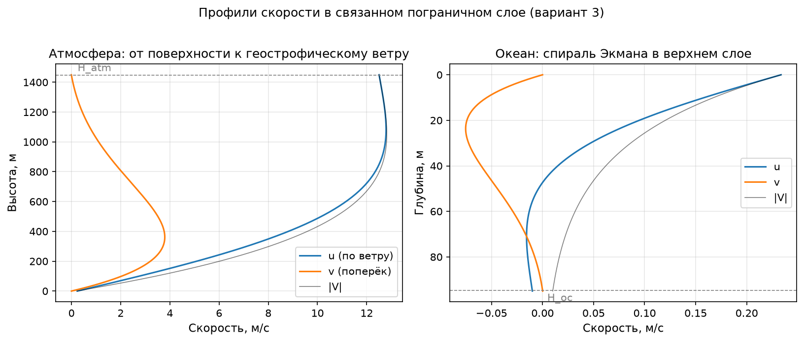

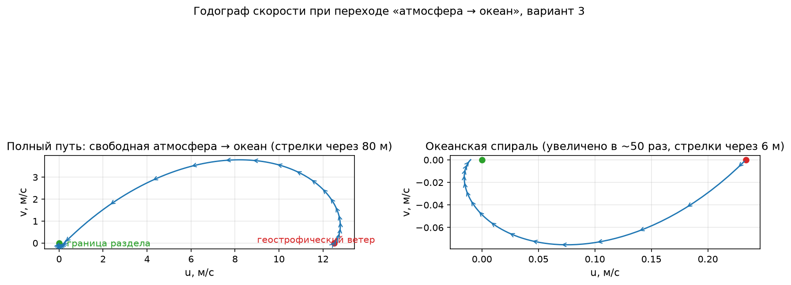

- толщина слоя атмосферы H_a ≈ 1.45 км, глубина проникновения течения H_o ≈ 95 м;
- скорость воды на границе раздела V₀ = ε·Vg/(1+ε) ≈ 0.23 м/с, где
  ε = (ρ_a/ρ_w)·√(k_a/k_w) ≈ 0.02 — контраст плотностей «съедает» импульс;
- решение проходит проверки непрерывности на границе раздела (в ноутбуке).

## 02 · Модель теплового взаимодействия океана и атмосферы

Три слоя (приземная атмосфера, верхний квазиоднородный слой, глубинный
слой) с линейным теплообменом; численные эксперименты с включёнными/выключенными
связями. Точное решение через собственные
числа, спектральная оценка времён релаксации и исследование сходимости схем.

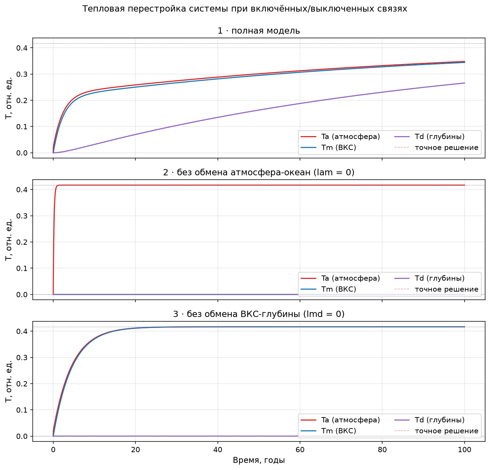

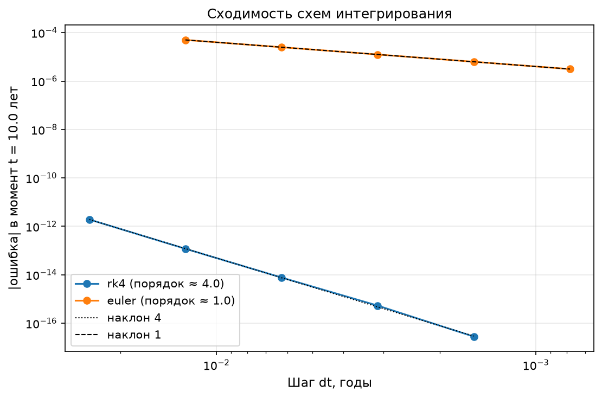

- быстрый обмен «атмосфера–ВКС» — дни, связь с глубинами — годы,
  прогрев глубокого океана — ~96 лет (e-folding по спектру оператора);
- фактический порядок точности: Эйлер ≈ 1.0, РК4 ≈ 4.0 (лог-лог наклоны).

## 03 · Длинные волны: разнесённая сетка и вычислительная дисперсия

Линейные уравнения мелкой воды (стенка слева, h = 100 м, A = 2 м,
T = 60 мин, бассейн 10λ ≈ 1128 км). Конечнр-разностная схема на C-сетке,
расходы на гранях ячеек, уровень в центрах. Два эксперимента — входящая
однопериодная волна и сейша из начального купола — с GIF-анимациями.

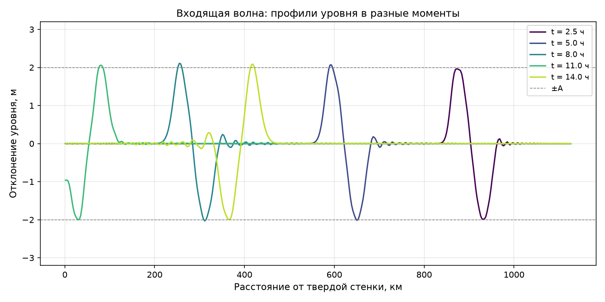

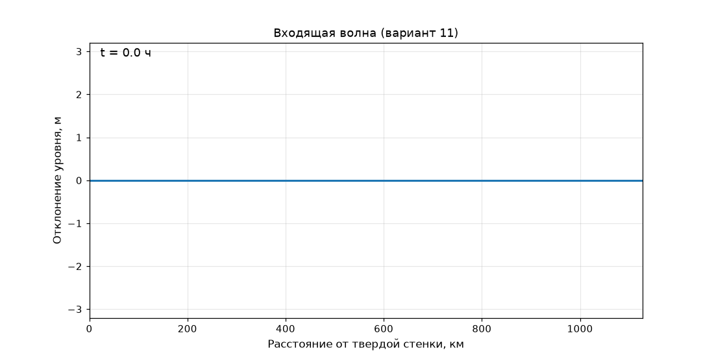

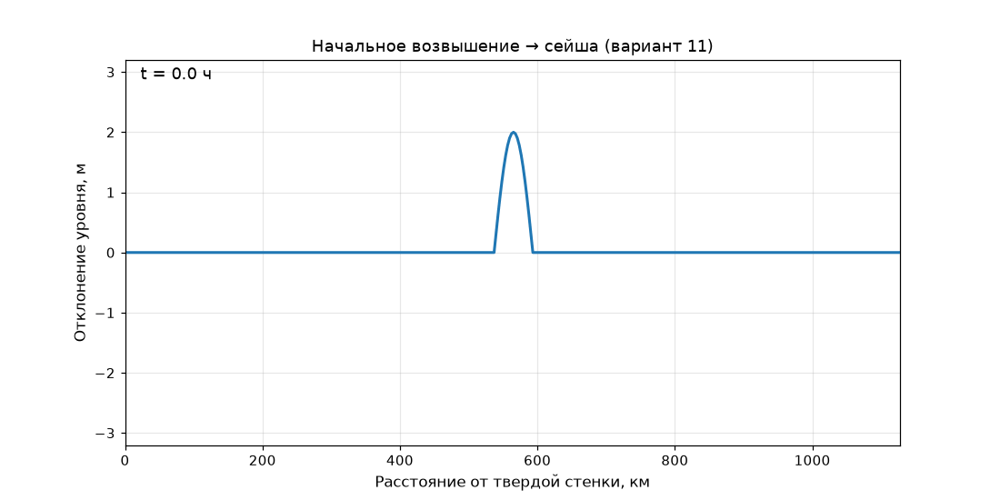

- воспроизведён механизм вычислительной дисперсии: рост ошибки амплитуды
  |1 − max|η|/A| по времени и скачок при интерференции с отражённой волной;

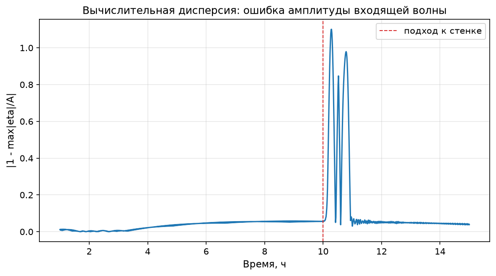

- исследование сходимости: та же ошибка падает с ~12% до ~1.4% при измельчении
  сетки с 8 до 80 ячеек на длину волны.

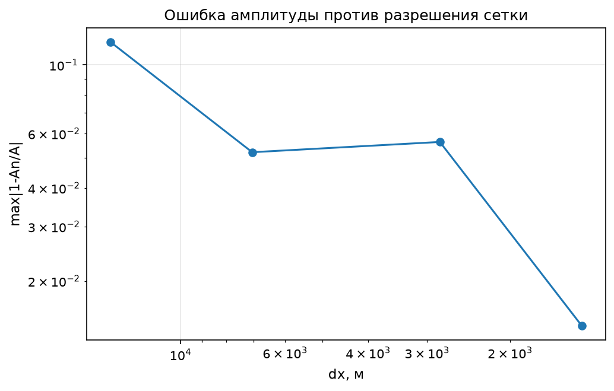

## 04 · Прогноз суточного стока Колымы: физическая модель против ML

Данные: 14 лет суточных расходов р. Колыма (2008–2021) 
и осадки метеостанции в текстовом файле. Полный цикл: загрузка и очистка →
модель → калибровка оптимизацией → верификация на отложенном периоде
(обучение 2008–2015, тест 2016–2021) против наивного инерционного прогноза.

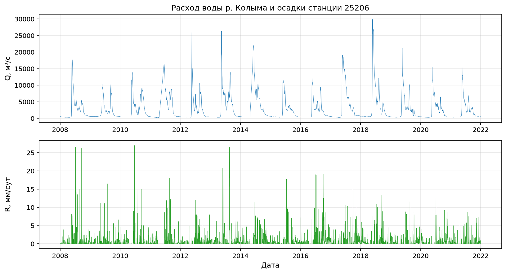

Верификация по гидрологическому критерию навыка S/σ_ΔQ < 1
(σ_ΔQ — СКО суточных изменений расхода, ошибка persistence по построению):

| модель | S/σ_ΔQ (тест) | P, % (тест) |
|---|---:|---:|
| persistence (наивный) | 1.00 | 88.0 |
| линейный резервуар (forward) | 9.2 | 26.2 |
| **градиентный бустинг (таргет ΔQ)** | **0.91** | **90.7** |

Калибровка параметров резервуара — двумерная оптимизация RMSE: карта потерь
по сетке (log a, τ) с уточнением L-BFGS-B (оптимум прижимается к границе —
типичный признак того, что входных признаков не хватает, и модель уходит
в вырожденный режим):

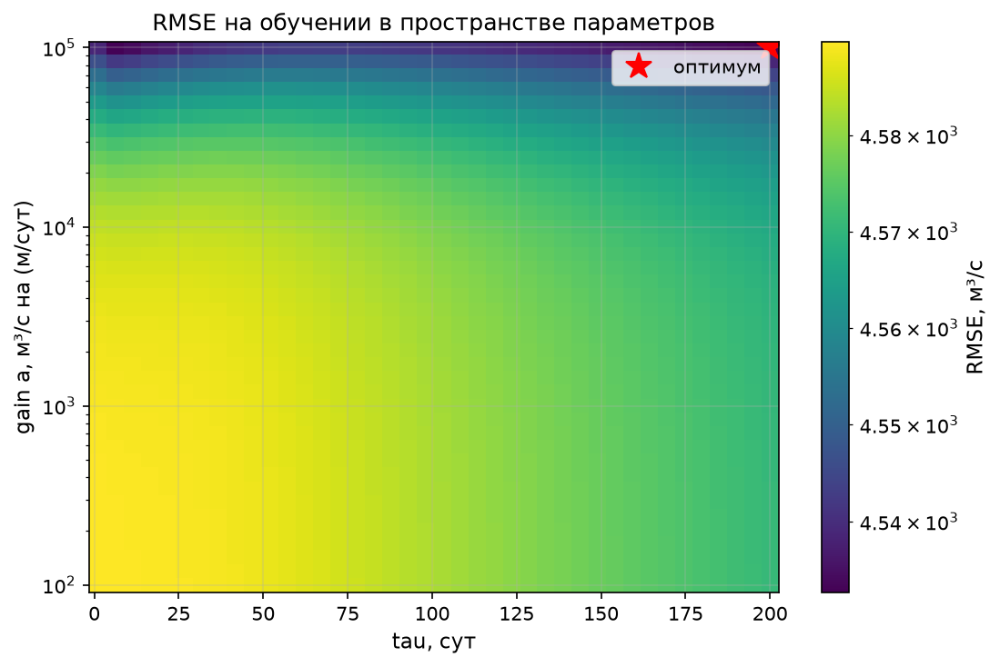

- **отрицательный результат физической модели верифицирован и объяснён**:
  корреляция осадков станции с приростами стока ≈ 0 (61% дней — без осадков),
  а главный процесс — снеготаяние — в модели не представлен;
- бустинг `HistGradientBoostingRegressor` над лагами расхода/осадков и
  календарём (таргет — прирост ΔQ, а не уровень) восстанавливает навык;
  топ-признаки по permutation importance — календарь и инерция стока:

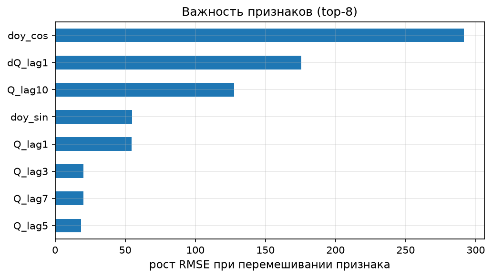

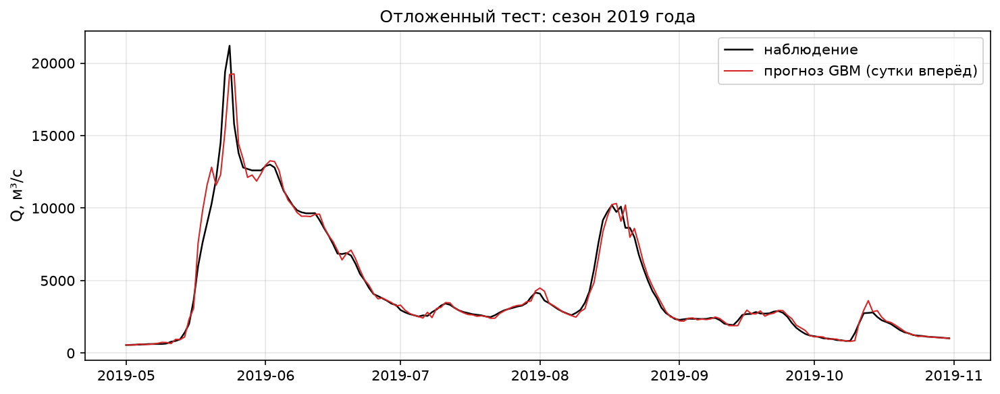

- бонус для инженерной части: замена пошагового `pd.concat` (как в исходном
  ноутбуке лабораторной) на preallocated `numpy`-массив ускоряет расчёт
  в ~350 раз.

---

## Инженерные и ML дополнения

- **Данные как pipeline**: загрузчики «сырых» Excel/TXT (разворот таблицы,
  парсинг дат, пропуски, единицы измерения), суточный датасет с валидацией
  индекса, воспроизводимый экспорт (`results/kolyma_daily.csv`);
- **численные методы как код**: РК4 и спектральное решение с assert-верификацией,
  разнесённые сетки, условие Куранта, исследование сходимости (порядок схем
  измерен, а не заявлен);
- **калибровка = оптимизация**: сеточный поиск по (log a, τ) с картой потерь +
  L-BFGS-B в лог-пространстве с границами; неустойчивые комбинации параметров
  получают штраф вместо `inf`;
- **верификация**: train/test по времени, сравнение с persistence,
  гидрологические критерии (S/σ_ΔQ, доля оправдавшихся прогнозов P);
- **ML**: анализ сигнала в признаках (корреляции с лагами), таргет
  ΔQ вместо уровня против регрессии к среднему.

## Структура репозитория

```
├── notebooks/            # выполненные ноутбуки (источник всех результатов)
│   ├── 01_ekman_boundary_layer.ipynb
│   ├── 02_ocean_atmosphere_box_model.ipynb
│   ├── 03_long_waves_1d.ipynb
│   └── 04_kolyma_runoff_forecast.ipynb
├── src/oahm/             # переиспользуемые модули моделей
│   ├── ekman.py          #   спираль Экмана, годограф
│   ├── box_model.py      #   боксовая модель, РК4, точное решение
│   ├── long_wave.py      #   1D уравнения мелкой воды, анимации
│   └── runoff.py         #   линейный резервуар, калибровка, метрики
├── data/raw/             # неизменённые исходные данные
├── figures/              # статичные иллюстрации (генерируются ноутбуками)
├── results/              # анимации GIF и обработанный датасет
├── pyproject.toml        # пакет oahm + зависимости
└── requirements.txt
```

## Быстрый старт

Через [uv](https://docs.astral.sh/uv/):

```bash
uv sync --extra dev
uv run jupyter lab notebooks/
```

или классически:

```bash
python -m venv .venv && source .venv/bin/activate
pip install -e ".[dev]"
jupyter lab notebooks/
```

Ноутбуки самодостаточны: если пакет `oahm` не установлен, они добавляют `src/`
в `sys.path`. Повторное выполнение всех ноутбуков (регенерирует `figures/` и
`results/`):

```bash
cd notebooks
jupyter nbconvert --to notebook --execute --inplace *.ipynb
```

## Данные

| файл | содержимое |
|---|---|
| `data/raw/kolyma_discharge_kamenka.xlsx` | суточный расход воды р. Колыма (пост Каменная Колыма), 2008–2021, широкий формат |
| `data/raw/precip_wr291058.txt` | суточные осадки метеостанции (индекс 25206), мм, разделитель `;` |
| `data/raw/wave_task_variants_2024.xlsx` | таблица вариантов задач по длинным волнам (используется вариант 11) |

## Стек

Python 3.10+ · numpy · pandas · scipy · scikit-learn · matplotlib
(+ Pillow для анимаций, openpyxl для чтения Excel)

## Происхождение

Проект переработан из учебных лабораторных работ по курсам «Моделирование
взаимодействия океана и атмосферы», «Моделирование океана» и «Моделирование
гидрологических процессов»: постановки и физика сохранены, вся математика
и весь пайплайн переписаны на Python, добавлены верификация, калибровка
оптимизацией и ML-часть.
